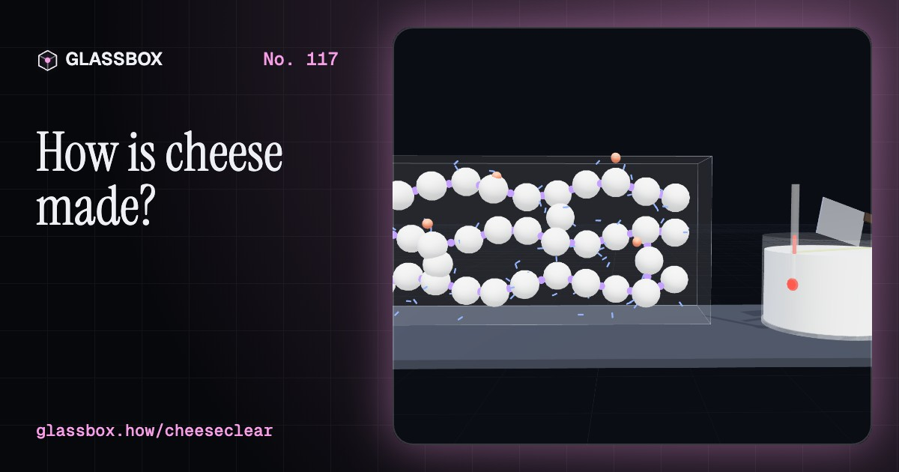
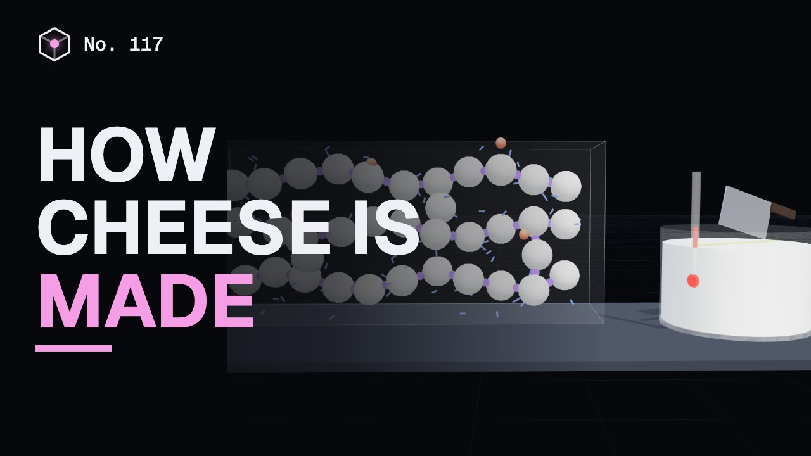
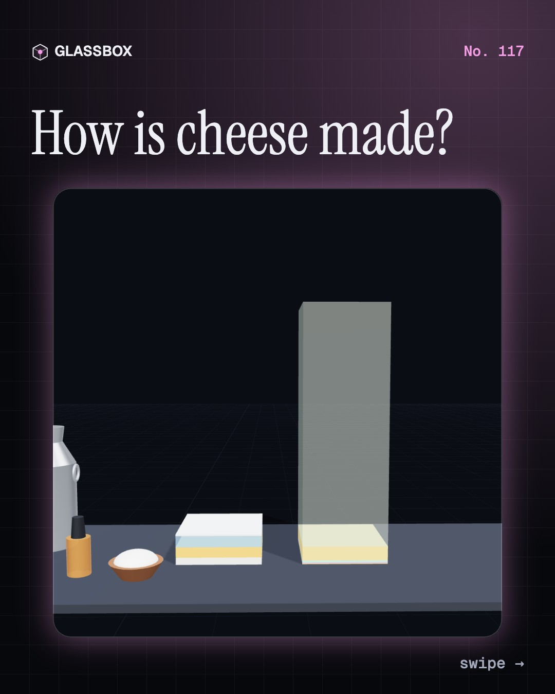
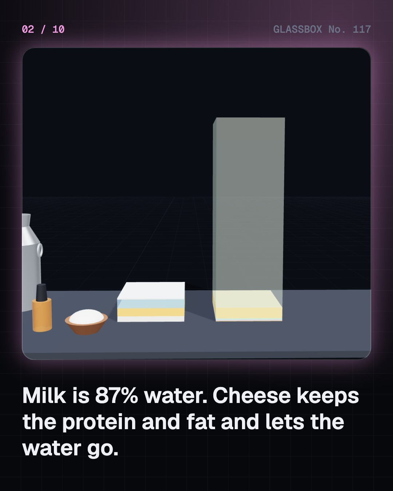
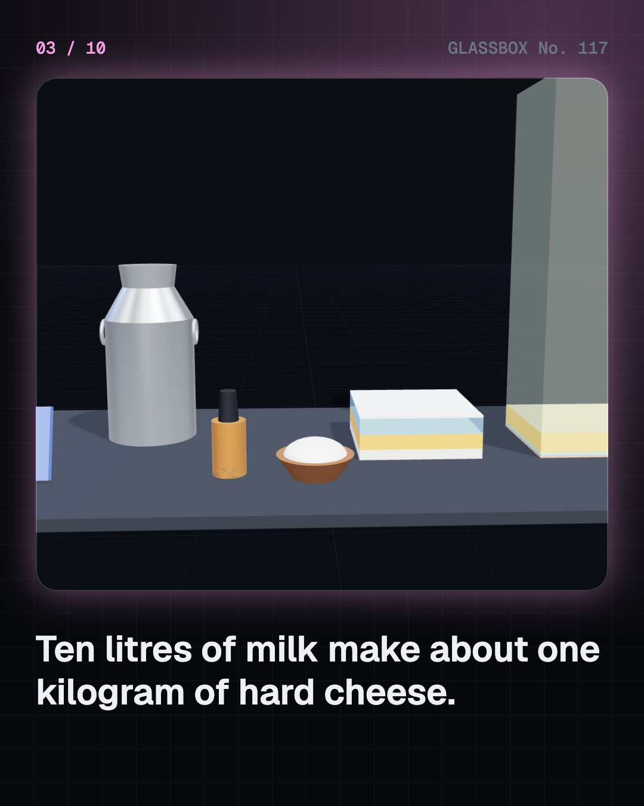
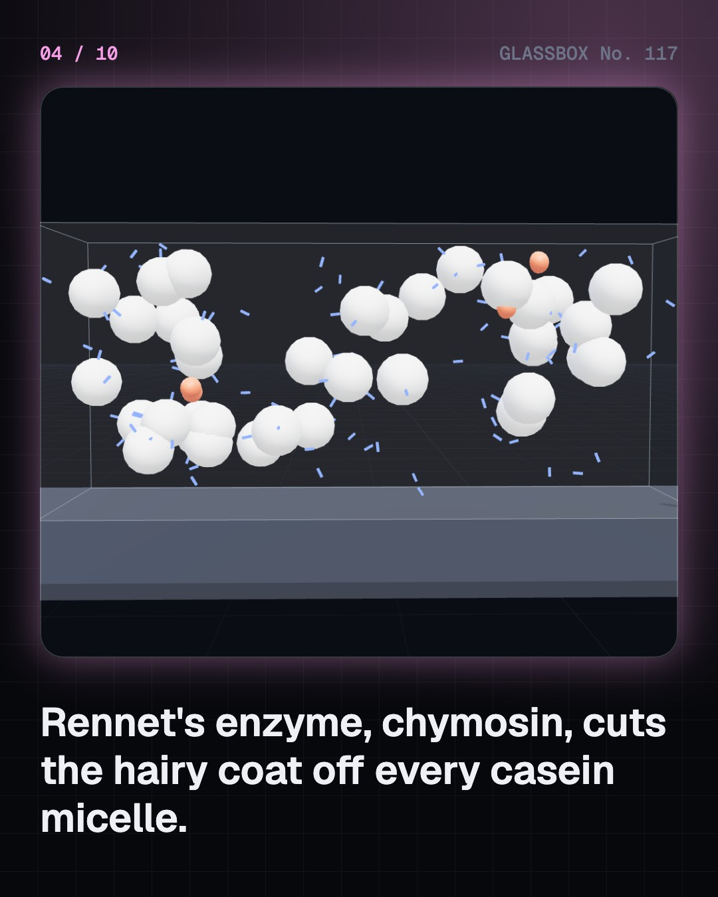

<!-- glassbox:start -->
<!-- Generated from glassbox.json by the Glassbox hub (npm run readme -- cheeseclear). Edit glassbox.json, not this block. -->
<p align="center"><a href="https://glassbox.how/e/cheeseclear/"></a></p>

<h1 align="center">CheeseClear</h1>

<p align="center"><b>How is cheese made?</b><br>Cheese is milk with nine-tenths of it taken away. Watch one enzyme snip the hairy coat off the milk's protein, cut and cook the curd, press it, salt it, and age it in a cave until bacteria blow the holes.</p>

<p align="center"><a href="https://glassbox.how/cheeseclear/"><b>▶ Play with it</b></a> &nbsp;·&nbsp; <a href="https://glassbox.how/e/cheeseclear/">Read the 60-second explainer</a> &nbsp;·&nbsp; <a href="https://glassbox.how/cheeseclear/glassbox/reel.mp4">Watch the 40-second video</a></p>

<p align="center">
  <a href="https://glassbox.how/e/cheeseclear/"></a>
  <a href="https://glassbox.how/e/cheeseclear/"></a>
  <a href="LICENSE"></a>
  <a href="LICENSE-CONTENT.md"></a>
  <a href="#privacy"></a>
</p>

## In 60 seconds

1. **Milk, minus the water.** Milk is about 87% water carrying fat, casein protein, lactose and a little whey protein. Cheese keeps the casein and fat and lets most of the water go. About 10 litres of cow milk make 1 kg of hard cheese. Four ingredients do it: milk, starter culture, rennet and salt.
2. **Rennet cuts the hairs.** Casein lives in tiny balls called micelles, each coated with kappa-casein hairs that keep them apart. Chymosin, the enzyme in rennet, cuts the hairs at one exact bond. The bald micelles link up through calcium and the whole vat sets into a soft gel, the curd.
3. **Cut, cook and drain.** Cutting the curd opens doors for the whey. Small cubes and hot cooking squeeze out more whey and give hard cheese. Big cubes and no cooking give soft cheese. Parmesan curd is cut to rice-grain size and cooked to about 55 °C. About nine-tenths of the milk drains away as whey.
4. **Press and salt.** Pressing knits loose curd into one solid block. Salt slows the microbes, draws out water and adds flavour. Cheddar is salted as chips before pressing. Many other cheeses float in brine, where salt creeps inwards by diffusion at about 0.2 cm² a day, so a big wheel takes weeks to even out.
5. **Flavour is made in the cave.** A young cheese is bland and rubbery. Over weeks to years, enzymes cut its protein and fat into small molecules with taste and smell. Temperature sets the pace. Propionic bacteria blow the holes in Emmental with carbon dioxide, and blue mould grows along needle holes that let air in.
6. **One family, many cousins.** How much water is left and how long it ages place every cheese on one map. Mozzarella stretches because its curd is soured to about pH 5.2 and pulled into fibres. Processed cheese melts smooth because emulsifying salts take the calcium. Paneer, set with acid and heat, does not melt at all.

## Words worth knowing

| Term | Meaning |
|---|---|
| **Casein micelle** | A ball of roughly 10,000 casein protein chains and calcium phosphate, about 150 nanometres wide. Cheese is built from these. |
| **Rennet and chymosin** | Rennet is a clotting enzyme mix. Its main enzyme, chymosin, cuts kappa-casein so that micelles can join into curd. |
| **Curd and whey** | Curd is the solid net of casein and trapped fat. Whey is the liquid that drains off with most of the water, lactose and whey protein. |
| **Starter culture** | Lactic acid bacteria added to cheese milk. They turn lactose into lactic acid and later release enzymes that build flavour. |
| **Syneresis** | A gel shrinking and squeezing out liquid. Cutting, cooking and stirring curd all speed it up. |
| **Cheddaring** | Stacking and turning slabs of curd so they stretch, drain and sour before they are milled, salted and pressed. |
| **Ripening** | Ageing cheese at a set temperature and humidity while enzymes and microbes develop its flavour and texture. |
| **Proteolysis** | The breakdown of protein into peptides and amino acids. It softens a cheese and makes much of its taste. |
| **Emulsifying salts** | Sodium citrate or phosphates that bind calcium, so processed cheese melts smoothly without separating. |

## A short history

**Seven thousand years from clay sieves on a Polish plain to enzymes brewed in steel tanks.**

- **5200 BCE** · Clay sieves strain the first known curds (Early farmers of the Linear Pottery culture, Kuyavia, Poland)
- **1600 BCE** · The oldest cheese that still exists (People of the Xiaohe cemetery, Tarim Basin, Xinjiang, China)
- **65** · A Roman writes down the recipe (Columella, Roman Empire (Italy))
- **1411** · Roquefort gets a royal monopoly (Charles VI of France, Roquefort-sur-Soulzon, France)
- **1650** · Bandel cheese in Bengal (Portuguese settlers and their Mog (Burmese) cooks, Bandel, Bengal, India)
- **1851** · The first American cheese factory (Jesse Williams, Rome, New York, USA)
- **1874** · Rennet in a bottle (Christian D. A. Hansen, Copenhagen, Denmark)
- **1906** · The microbes get names (Eduard von Freudenreich, Sigurd Orla-Jensen and Charles Thom, Bern, Switzerland and Connecticut, USA)

The full story, with 30 moments, charts, people and 41 sources: [glassbox.how/e/cheeseclear/history](https://glassbox.how/e/cheeseclear/history/). The data lives in [`history.json`](history.json).

## Video and slides

Made with the Glassbox studio from this box's storyboard (`window.glassbox.director`). Free to reuse under CC BY 4.0.

<a href="https://glassbox.how/cheeseclear/glassbox/video.mp4"></a>

<p><a href="glassbox/slide-1.jpg"></a> <a href="glassbox/slide-2.jpg"></a> <a href="glassbox/slide-3.jpg"></a> <a href="glassbox/slide-4.jpg"></a></p>

| File | What | Size |
|---|---|---|
| [`glassbox/reel.mp4`](https://glassbox.how/cheeseclear/glassbox/reel.mp4) | Reel / Short, with captions and soundtrack | 1080×1920 |
| [`glassbox/video.mp4`](https://glassbox.how/cheeseclear/glassbox/video.mp4) | YouTube video, with captions and soundtrack | 1920×1080 |
| `glassbox/slide-1…10.jpg` | Instagram carousel | 1080×1350 |
| `glassbox/thumb.jpg` | YouTube thumbnail | 1280×720 |
| `glassbox/cover.jpg` | Share card and repo social preview | 1200×630 |
| [`glassbox/history-reel.mp4`](https://glassbox.how/cheeseclear/glassbox/history-reel.mp4) | “History in 10 moments” Reel / Short | 1080×1920 |
| `glassbox/history-slide-*.jpg` | History carousel | 1080×1350 |
| `glassbox/post.json` | Post copy and schedule used by the publish kit | |

## Privacy

This box has no accounts and no ads, and it ships its own fonts and libraries. When you run it yourself it sends nothing anywhere. On glassbox.how, the site's `/bar.js` also loads Glassbox's analytics: **Google Analytics** to count visits (it asks first in the EU, UK and Switzerland, and stays off when your browser sends Global Privacy Control or Do Not Track) and **ClickTrust** to detect bots.

It remembers a few things **in your own browser only**, and never sends them anywhere:

| Browser storage key | What it holds |
|---|---|
| `cheeseclear.v1` | Which chapters you have opened, your best quiz scores, and sound on or off. |

Exactly what each one sees is at [glassbox.how/privacy](https://glassbox.how/privacy/).

## Licences

- **Code:** [MIT](LICENSE). Use it, change it, ship it.
- **Explanations, text, images and videos** (`glassbox.json`, `glassbox/`): [CC BY 4.0](LICENSE-CONTENT.md). Credit “Glassbox, glassbox.how/e/cheeseclear”.
- **Third-party parts** keep their own licences: [three.js](https://threejs.org) (MIT), [Geist, Instrument Serif](https://openfontlicense.org) (SIL OFL 1.1).
- The Glassbox name and logo aren't covered by either licence. See the [terms](https://glassbox.how/terms/).

Found a mistake? [Open an issue](https://github.com/bdeeps/cheeseclear/issues). Corrections happen in public.
<!-- glassbox:end -->

## Run it

It's plain HTML, CSS and JavaScript. No build step and no dependencies. Run locally, it contacts no other website.

```bash
python3 -m http.server 8000
```

Three.js and the fonts ship in `vendor/` and `fonts/`, so it also works offline.

Then open http://localhost:8000.

## How it's built

| File | What |
|---|---|
| `index.html`, `css/app.css` | The page and its styles |
| `js/app.js`, `js/stage.js`, `js/ui.js`, `js/kit.js` | The shared Glassbox 3D engine: chapters, 3D stage, controls, quiz, video director |
| `js/chapters/*.js` | One file per chapter: the 3D model, controls, text, key terms, quiz and video scenes |
| `js/cheese.js` | Shared dairy science and helpers: milk composition, the Van Slyke yield formula, the rennet clotting model, curd moisture, salt diffusion, ripening curves, the cheese family table, chart boards and 3D pieces |
| `glassbox.json` | Title, question, explainer beats, key terms, browser storage and credits shown on glassbox.how |
| `reel` in each chapter | The storyboard the Glassbox studio records into short videos |
| `glassbox/` | The published video, slides, thumbnail and post copy |
| `fonts/`, `vendor/three/` | Self-hosted Geist and Instrument Serif (SIL OFL 1.1) and three.js (MIT) |
